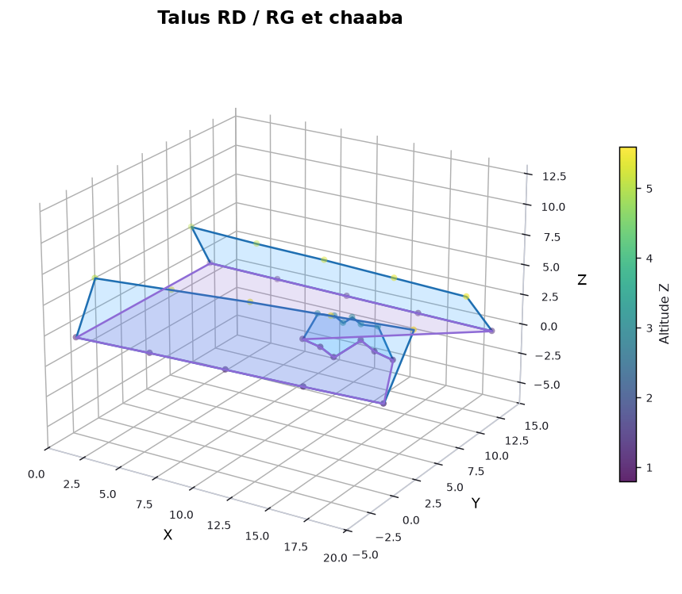
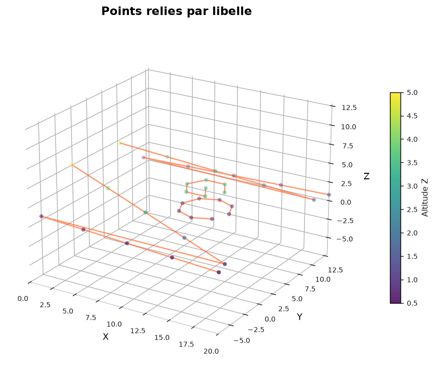
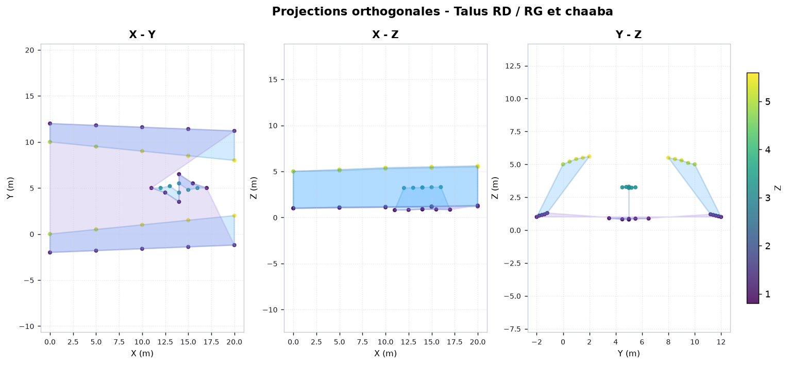

# MK_3D

[](https://www.python.org/)
[](#)
[](https://github.com/TomSchimansky/CustomTkinter)
[](LICENSE)
[](https://github.com/km1965/MK_3D/releases/latest)

Application **Windows** (Python + CustomTkinter) pour créer des **figures 3D / 2D**
à partir d'un fichier de points **XYZ** (Excel ou CSV), relier les points par
**libellé**, **matérialiser les talus** (polygones fermés) et générer un
**rapport Word (.docx)** contenant les images produites.

---

## Téléchargement

L'exécutable autonome **`Mk_MNT_3D.exe`** (aucune installation de Python requise)
est disponible dans les versions :

**[Télécharger la dernière version](https://github.com/km1965/MK_3D/releases/latest)**

---

## Aperçu

**Talus RD / RG et chaaba** — faces fermées (profils bas ↔ haut) et fermeture de la base :



**Polylignes par libellé** — chaque libellé relie ses points :



**Projections orthogonales 2D** (X-Y, X-Z, Y-Z) :



---

## 1. Aperçu des fonctionnalités

- Import de fichiers `.xlsx`, `.xlsm`, `.xls`, `.csv`, `.txt`
- Détection automatique des colonnes `X`, `Y`, `Z` et de la colonne de **libellé**
- Sélection de la feuille Excel
- Aperçu des données : tableau + statistiques (Min / Max / Moyenne / Écart-type)

**Figures générées** (PNG haute résolution) :

- Nuage de points **3D** coloré selon l'altitude Z
- Projections orthogonales **X-Y**, **X-Z**, **Y-Z**
- Planche récapitulative des trois projections
- **Aperçu interactif 3D** (rotation à la souris, zoom, barre d'outils matplotlib)

**Mises en forme des données** :

- **Lier les points par libellé** : relie les points partageant le même libellé
  par une polyligne (dans l'ordre du fichier).
- **Matérialiser les talus** : crée des **polygones fermés** en reliant un profil
  *bas* et un profil *haut* d'un même côté.
- **Fermer la base** : relie les lignes de pied des différents côtés par leurs
  extrémités les plus proches, pour matérialiser la surface de base.
- **Remplir les faces** : remplissage semi-transparent des polygones.

**Rapport Word** : page de titre, statistiques descriptives, figures légendées,
introduction et conclusion.

---

## 2. Format des données

Le fichier doit contenir **au moins 3 colonnes numériques** : X, Y et Z.
Les colonnes sont reconnues automatiquement (insensible à la casse et aux
accents) :

| Axe | Noms reconnus |
|-----|----------------|
| X | `x`, `x (m)`, `east`, `est`, `easting`, `abscisse` |
| Y | `y`, `y (m)`, `north`, `nord`, `northing`, `ordonnee` |
| Z | `z`, `z (m)`, `alt`, `altitude`, `elev`, `elevation`, `cote` |

**Colonne de libellé** (facultative, nécessaire pour les polylignes et les talus) :

| Type | Noms reconnus |
|------|----------------|
| Libellé | `libelle`, `label`, `nom`, `name`, `designation`, `point`, `point_id`, `numero`, `n°`, `batiment`, `ouvrage`, `groupe`, `code`, `repere` |

Si aucune colonne nommée n'est trouvée, les trois premières colonnes numériques
sont utilisées comme X, Y, Z.

### Exemple minimal

| X | Y | Z | LIBELLE |
|---|---|---|---------|
| 100.0 | 200.0 | 1.0 | TD_BAS |
| 102.0 | 200.5 | 1.1 | TD_BAS |
| 100.0 | 200.0 | 5.0 | TD_HAUT |
| 102.0 | 200.5 | 5.2 | TD_HAUT |

---

## 3. Libellés, polylignes et faces de talus

### 3.1 Principe

Un **libellé** décrit un ensemble de points. L'application sait reconnaître un
**niveau** à partir des mots-clés présents dans le libellé :

- **Niveau bas** : `bas`, `basse`, `pied`, `inf`, `inférieur`, `aval`, `bottom`
- **Niveau haut** : `haut`, `haute`, `crête`, `crete`, `sommet`, `top`, `sup`,
  `supérieur`, `amont`, `dessus`

Tout le reste du libellé (moins le mot de niveau) définit le **côté**.

Les séparateurs `_`, `-`, `.`, `/`, `,`, `;` sont traités comme des espaces, et
la casse/les accents sont ignorés.

| Libellé saisi | Côté détecté | Niveau détecté |
|---------------|--------------|----------------|
| `TD_HAUT` | `td` | haut |
| `TD_BAS` | `td` | bas |
| `RD Talus bas` | `rd talus` | bas |
| `Crête RG` | `rg` | haut |
| `pied du talus RD` | `du talus rd` | bas |

### 3.2 Lier les points par libellé (polyligne)

Coche **« Lier les points par libellé »** pour relier, par une polyligne, tous
les points partageant le même libellé (dans l'ordre du fichier). Pratique pour
visualiser un profil ou une ligne d'auscultation.

### 3.3 Matérialiser les talus (polygones fermés)

Coche **« Matérialiser les talus »**. Pour chaque **côté** possédant à la fois
un profil *bas* et un profil *haut* (au moins 2 points chacun), l'application :

1. Trie chaque profil le long de son axe principal (analyse en composantes
   principales dans le plan XY) afin d'éviter les arêtes croisées.
2. Ré-échantillonne les deux profils sur un même nombre de points (si les
   effectifs diffèrent), régulièrement espacés le long de la courbe.
3. Construit un **polygone fermé** : `Bas₁ → Bas₂ → … → Basₙ → Hautₙ → … → Haut₁ → Bas₁`.

Le résultat est affiché en **3D** et dans les **projections 2D**. Si
**« Remplir les faces »** est cochée, la face est remplie en semi-transparent.

> Exemple : un talus droit avec `TD_BAS` (5 points, z ≈ 1 m) et `TD_HAUT`
> (5 points, z ≈ 5 m) produit un polygone à 10 sommets, correctement orienté.

### 3.4 Fermer la base

Coche **« Fermer la base »** pour relier les lignes de **pied** (profils bas)
des différents côtés par leurs **extrémités les plus proches**. Cela matérialise
la surface de base entre les talus (par exemple entre `TD` et `TG`).

---

## 4. Menu Fichier

La fenêtre dispose d'un menu **Fichier** :

| Commande | Raccourci | Action |
|----------|-----------|--------|
| Nouveau | `Ctrl+N` | Efface les données et les figures |
| Ouvrir… | `Ctrl+O` | Importe un nouveau fichier XYZ |
| Enregistrer | `Ctrl+S` | Réenregistre les données (CSV/Excel) |
| Enregistrer sous… | `Ctrl+Maj+S` | Enregistre les données sous un nouveau nom |
| Quitter | `Alt+F4` | Ferme l'application |

Lors de l'enregistrement, les colonnes sont écrites `X`, `Y`, `Z` et, si
présente, la colonne de libellé.

---

## 5. Utilisation pas à pas

1. Cliquer sur **Importer Excel / CSV** et choisir un fichier de points XYZ.
2. (Excel) Choisir la **feuille** dans la liste déroulante.
3. Ajuster les **paramètres des figures** dans le panneau de gauche
   (titre, taille des points, palette, dpi, grille, inversion Z, fond sombre).
4. Cocher éventuellement **Lier les points par libellé**, **Matérialiser les
   talus**, **Fermer la base**, **Remplir les faces**.
5. Cliquer sur **Générer les figures** → elles apparaissent dans l'onglet
   *Figures*.
6. (Optionnel) **Aperçu interactif 3D** pour explorer et faire tourner le nuage.
7. Onglet *Rapport* → renseigner titre/auteur/sujet → **Générer le rapport Word**.

Les fichiers produits sont rangés dans le dossier
`output/<nom_fichier>_<horodatage>/`.

---

## 6. Installation et lancement

```powershell
py -3.14 -m venv .venv
.\.venv\Scripts\python.exe -m pip install -r requirements.txt
.\.venv\Scripts\python.exe app.py
```

Ou **double-cliquer sur `run.bat`** (installe l'environnement au besoin).

---

## 7. Exécutable Windows

L'application est empaquetée en un **exécutable autonome** :

```
dist\Mk_MNT_3D.exe
```

- Un seul fichier, **aucune installation de Python requise**.
- Le dossier `output\` est créé automatiquement à côté de l'exécutable.

Pour régénérer l'exécutable :

```powershell
.\.venv\Scripts\python.exe -m PyInstaller Mk_MNT_3D.spec
```

ou `build_exe.ps1` / `build_exe.bat`.

---

## 8. Données d'exemple

```powershell
# Jeu de 600 points (sans libellé)
.\.venv\Scripts\python.exe tools\make_sample_data.py

# Jeu de test des polylignes (35 points, avec libellés)
# -> sample_data\test_liens.xlsx

# Jeu de test des talus RD/RG + chaaba (avec bas/haut)
# -> sample_data\exemple_talus_chaaba.xlsx
```

---

## 9. Tests sans interface

```powershell
.\.venv\Scripts\python.exe tools\smoke_test.py   # import + figures + rapport
.\.venv\Scripts\python.exe tools\gui_smoke.py    # démarrage de l'interface
```

---

## 10. Structure du projet

```
MK_3D/
├─ app.py                    # interface CustomTkinter (+ menu Fichier)
├─ mk3d/
│  ├─ data_loader.py         # import, détection colonnes/libellés, niveaux bas/haut
│  ├─ plotting.py            # figures 3D/2D, polylignes, faces de talus
│  └─ report.py              # génération du rapport Word
├─ assets/
│  ├─ mk_mnt_3d.ico         # icône de l'application
│  └─ mk_mnt_3d.png
├─ docs/                     # images d'aperçu (README)
├─ sample_data/             # jeux de données d'exemple
├─ tools/                   # génération de données, icône et tests
├─ requirements.txt
├─ Mk_MNT_3D.spec           # recette PyInstaller
├─ build_exe.ps1 / .bat     # compilation de l'exécutable
├─ run.bat                  # lancement rapide
├─ LICENSE                  # licence MIT
└─ dist/Mk_MNT_3D.exe       # exécutable généré
```

---

## 11. Dépannage

| Problème | Solution |
|----------|----------|
| « Impossible d'identifier 3 colonnes numériques » | Vérifier que le fichier contient bien des coordonnées X, Y, Z numériques et nommées. |
| Aucune face de talus générée | Vérifier que les libellés contiennent un mot de niveau (`bas`/`haut`) et que le même côté possède au moins 2 points *bas* et 2 points *haut*. |
| Le format `.xls` échoue | Installer `xlrd` (`pip install xlrd`) ou convertir en `.xlsx`. |
| Erreur au démarrage de l'exe | Vérifier que `dist\Mk_MNT_3D.exe` est bien à jour (recompiler via `Mk_MNT_3D.spec`). |

---

## 12. Licence

Ce projet est distribué sous licence **MIT** — voir le fichier [LICENSE](LICENSE).
